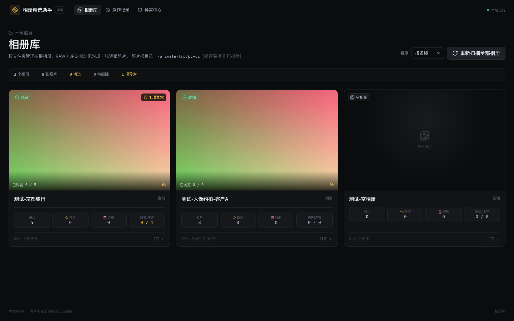
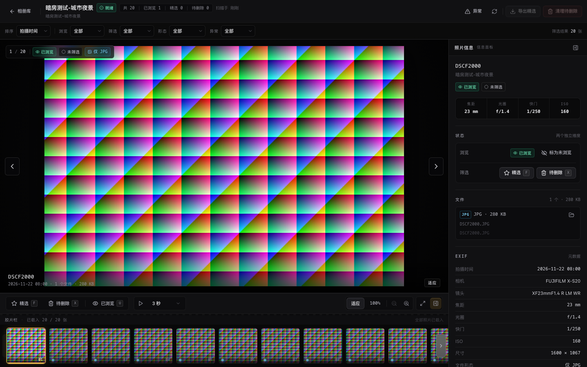
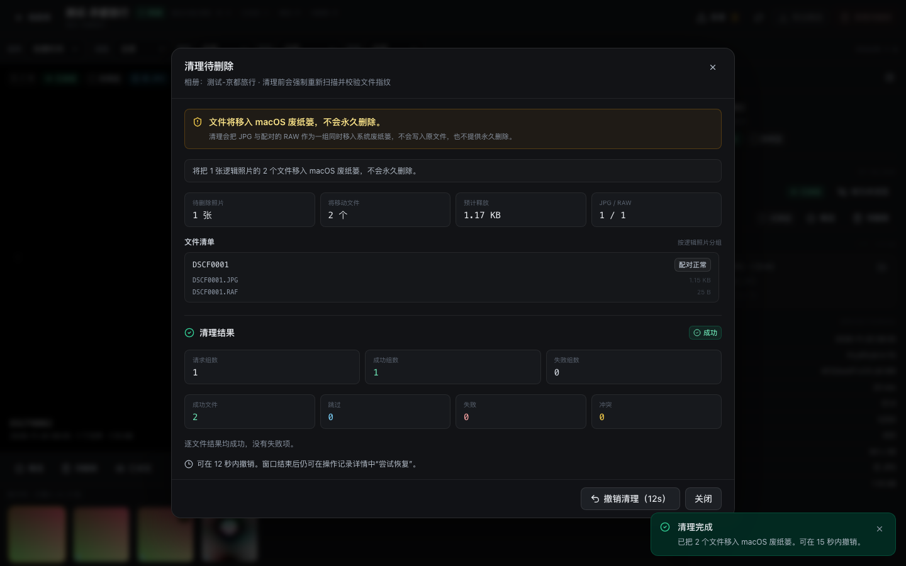
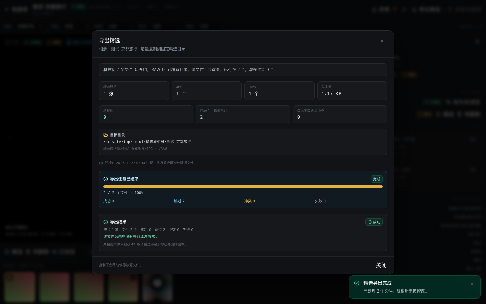
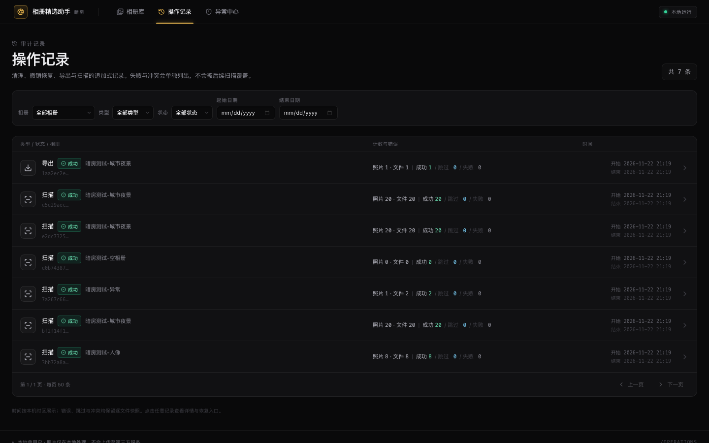
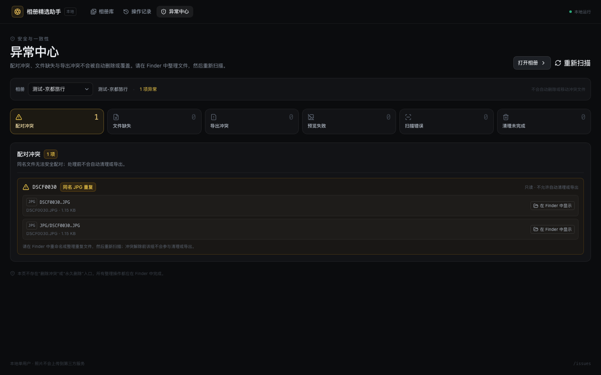
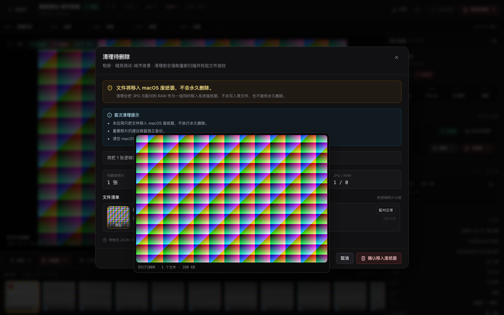
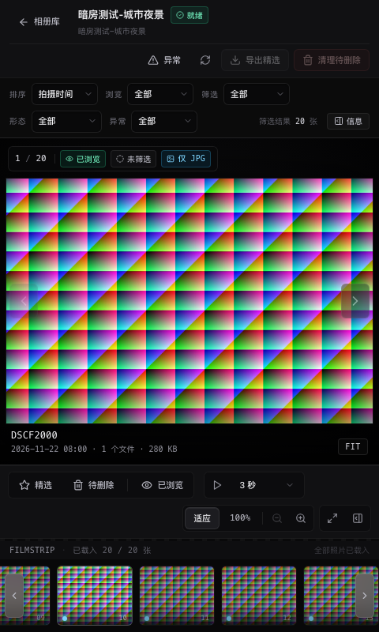
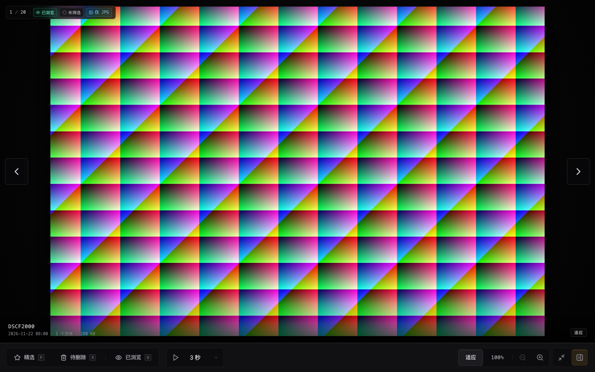
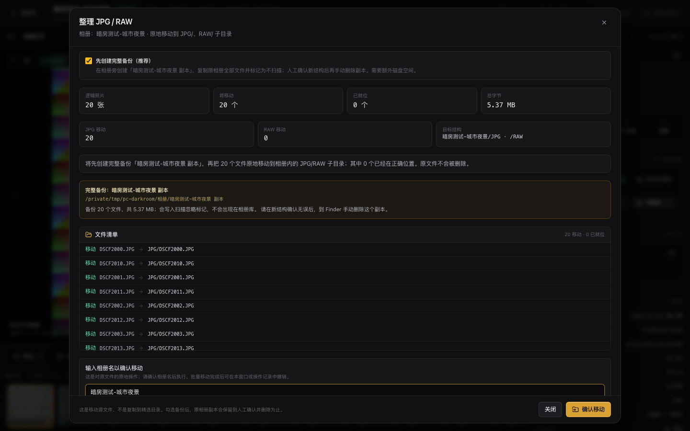

# 相册精选助手（Photo Curator）

本地单用户的 macOS 相册精选工具：把同一快门的 RAW＋JPG 作为一张逻辑照片浏览，记录独立的两维状态，按两阶段流程把待删除照片移入 macOS 废纸篓，并把精选照片增量复制到统一的 `精选原相册` 目录。

> 本项目只在本机运行，前后端都只监听 `127.0.0.1`；不上传照片、不连接云服务、不提供登录或公网访问。
> **开发与自动化测试只使用临时夹具，绝不操作用户真实相册。** 默认照片根目录是 `~/Desktop/相册`，仅在用户主动启动应用时读取。

## 功能

- **相册库**：扫描照片根目录的一级子文件夹；支持旅行、人像约拍等任意拍摄主题；封面、浏览进度、精选/待删除/缺失/冲突统计。
- **RAW／JPG 配对**：按 NFC 规范化、不区分大小写的主文件名配对；同格式重名、多个 RAW 格式等情况标记配对冲突并禁止自动清理/导出。
- **顺序浏览**：默认适应屏幕的大图查看、缩放/拖动/全屏、自动播放、虚拟化胶片栏、左右翻批按钮、±2 张预加载、快捷键（`←` `→` `F` `X/Delete` `Space` `I` `U` `Esc`）。
- **两个独立状态**：浏览状态（未浏览／已浏览）与筛选状态（未筛选／精选／待删除）；乐观锁版本控制，409 不静默覆盖。
- **两阶段清理**：`X`/`Delete` 只标记；「清理待删除」→ 重新扫描生成预检（带缩略图与悬浮放大预览）→ 明确确认 → 按逻辑照片分组移入 macOS 废纸篓；失败组自动回滚，回滚失败会严重报错并记录实际位置；支持 15 秒撤销与操作详情中的恢复。
- **精选导出**：复制（绝不移动）到 `精选原相册/<相册名>/JPG|RAW`；流式复制、临时文件、内容哈希、同名同内容跳过、同名不同内容不覆盖；增量导出。
- **原地整理 JPG/RAW**：把相册里的 JPG、RAW 分别移动到相册内的 `JPG/`、`RAW/` 子目录；预检 + 输入相册名二次确认 + 逐文件操作记录，可从结果或操作记录撤销。默认先创建完整备份 `<相册名> 副本`（扫描忽略），人工确认新结构后手动删除；状态和操作记录自动跟随。目标已存在、配对冲突、文件缺失、备份空间不足或预检后变化时整批拒绝，绝不覆盖。
- **可追溯**：清理、恢复、导出、扫描、原地整理均有操作记录与逐文件明细；应用崩溃时未完成任务标记为「中断，需核对」。
- **外部变化**：监听当前相册，去抖后完整校对扫描；重启后以扫描结果为准；缺失状态保留，文件恢复后自动合并。
- **异常中心**：配对冲突、文件缺失、导出冲突、RAW 预览失败、扫描错误；可在 Finder 中显示并在处理后重新扫描。

## 界面预览

| 相册库 | 照片筛选器 |
| --- | --- |
|  |  |
| **清理预检与结果（可撤销）** | **精选导出进度与结果** |
|  |  |
| **操作记录** | **异常中心** |
|  |  |
| **清理缩略图悬浮预览** | **窄窗口布局（480px）** |
|  |  |
| **全屏沉浸操作（大按钮）** | **原地整理 JPG/RAW** |
|  |  |

界面采用暗房（Darkroom）主题：炭黑与黄铜色、灯箱式相册封面、单行工作台顶栏；装饰性小标签已全部中文化。截图使用 `/tmp` 下由脚本生成的测试相册与合成图片，不包含任何私人照片。

## 环境要求

| 组件 | 要求 | 本次验证环境 |
| --- | --- | --- |
| macOS | 支持 `NSFileManager.trashItemAtURL` 的原生废纸篓 | macOS 26.4.1（arm64） |
| Python | 3.11 – 3.13 | 3.12.13 |
| Node.js | ≥ 20.19（或 ≥ 22.12） | 26.0.0（npm 11.12.1） |
| SQLite | Python 内置 | 内置 |
| rawpy / LibRaw | 由 Python 依赖自动安装 | rawpy 0.28.0 |
| ExifTool | **可选**，推荐安装以读取 RAW 元数据 | 未安装时健康检查提示，不影响浏览 |
| PyObjC | 由 Python 依赖自动安装（macOS 原生废纸篓） | 13.0 |

安装 ExifTool（可选）：

```bash
brew install exiftool
```

未安装 ExifTool 时：JPG 的 EXIF 仍由 Pillow 读取；RAW-only 照片的拍摄时间/相机信息显示为“未知”，并回退到自然文件名排序。不会伪造元数据。

## 快速开始

```bash
# 1. 安装 Python 与前端依赖（需要 uv；也可以按下方“手动安装”）
npm run setup

# 2. 启动前后端（默认 http://127.0.0.1:7100，API 127.0.0.1:8765）
npm run dev
```

打开 <http://127.0.0.1:7100>。停止：在终端按 `Ctrl+C`（根命令会同时停止 Vite 与 Uvicorn）。

自定义端口/主机：

```bash
npm run dev -- --host 127.0.0.1 --port 7200 --api-port 8765
```

根命令会把 host/port 转发给 Vite，并同步设置后端的 Origin 白名单。禁止把 host 改成 `0.0.0.0`；安全中间件只接受本机回环 Host。

### 手动安装（不使用 uv）

```bash
python3.12 -m venv .venv
.venv/bin/pip install -e ".[dev]"
npm install
npm run dev
```

### 生产模式（单端口同源）

```bash
npm run build
.venv/bin/python -m uvicorn photo_curator.main:app --host 127.0.0.1 --port 8765
```

打开 <http://127.0.0.1:8765>。后端会以同源方式托管 `apps/web/dist`。

## 配置

配置全部来自环境变量（可写入仓库根目录的 `.env`，该文件已被 gitignore）：

| 变量 | 默认值 | 说明 |
| --- | --- | --- |
| `PHOTO_CURATOR_ROOT` | `~/Desktop/相册` | 照片根目录；只扫描其一级子文件夹 |
| `PHOTO_CURATOR_DATA_DIR` | `<repo>/data` | 数据库、预览缓存、会话令牌 |
| `PHOTO_CURATOR_EXPORT_DIR_NAME` | `精选原相册` | 精选导出目录名称，固定位于照片根目录内，自动从源相册排除 |
| `PHOTO_CURATOR_HOST` / `PHOTO_CURATOR_PORT` | `127.0.0.1` / `8765` | 后端监听地址 |
| `PHOTO_CURATOR_WEB_HOST` / `PHOTO_CURATOR_WEB_PORT` | `127.0.0.1` / `7100` | Vite 开发服务器地址，同时用于 Origin 白名单 |
| `PHOTO_CURATOR_STARTUP_SCAN` | `1` | 启动后后台扫描全部相册 |
| `PHOTO_CURATOR_PREVIEW_CONCURRENCY` | `2` | RAW 解码并发上限 |
| `PHOTO_CURATOR_ALLOWED_HOSTS` | `127.0.0.1,localhost,::1` | 防 DNS rebinding 的 Host 白名单 |
| `PHOTO_CURATOR_EXIFTOOL` | 自动查找 | ExifTool 路径 |
| `PHOTO_CURATOR_SESSION_TOKEN` | 自动生成 | 仅测试使用；生产请留空 |

完整示例见 [`.env.example`](.env.example)。

### 使用测试根目录

**不要**让自动化测试指向真实相册。项目提供了只写入指定目录的夹具生成器：

```bash
.venv/bin/python scripts/create-fixtures.py --root /tmp/photo-curator-demo --clean
PHOTO_CURATOR_ROOT=/tmp/photo-curator-demo \
PHOTO_CURATOR_DATA_DIR=/tmp/photo-curator-demo-data \
npm run dev
```

生成器会拒绝 `~/Desktop/相册` 及其子目录。夹具包含旅行、人像约拍、空相册、配对冲突、RAW-only 合成 DNG、精选目录等场景，全部由程序生成，不含私人照片。

## 数据位置与备份

| 内容 | 默认位置 | 说明 |
| --- | --- | --- |
| SQLite 数据库 | `data/photo-curator.sqlite3`（含 `-wal`/`-shm`） | 相册、状态、操作记录 |
| 预览缓存 | `data/cache/previews/` | 缩略图/预览 JPEG；可安全删除，会按需重建 |
| 本地会话令牌 | `data/session-token` | 0600 权限；不会写入日志或操作记录 |
| 源照片 | 用户配置的照片根目录 | 常规浏览只读；清理时移入 macOS 废纸篓；「原地整理」会移动 JPG/RAW 路径（预检 + 二次确认 + 可撤销）；导出只写入精选目录 |

**备份数据库**（先停止应用，避免复制到写入中的 WAL）：

```bash
sqlite3 data/photo-curator.sqlite3 ".backup 'photo-curator-backup.sqlite3'"
```

恢复：停止应用，把备份文件放回 `data/photo-curator.sqlite3`（删除旧的 `-wal`/`-shm` 后启动）。

## 测试

```bash
# 后端：单元 + 集成 + 真实 macOS 废纸篓 + 性能
.venv/bin/python -m pytest

# 仅性能
.venv/bin/python -m pytest tests/performance -s

# 前端单元/交互测试
npm test

# 前端类型检查与生产构建
npm run typecheck
npm run build

# Playwright 端到端（使用临时夹具与专用 API 端口；首次需安装浏览器）
npx playwright install chromium
npm run test:e2e
```

真实 RAW 只读验证：已用一个真实的富士 X-S20 RAF 相册（975 个文件，407 个 RAF 全部与同名 JPG 配对）完成只读扫描与预览验证；407/407 个 RAF 由 LibRaw 成功打开，抽样解码与缩略图/预览生成正常。另用 Homebrew 安装的 ExifTool 13.55 读取了 407/407 个 RAF 的拍摄时间、镜头、光圈、快门、ISO 与尺寸（ImageSize 6240×4160），并在一个 RAF-only 临时副本上验证了无 JPG 时的元数据与预览链路。源目录未被修改，验证样本没有提交到仓库。

测试约束（硬性）：

- 自动化测试绝不使用 `~/Desktop/相册`；所有根目录指向 pytest/Playwright 临时目录。
- 配对、路径、状态机、导出冲突、清理回滚、幂等、崩溃恢复均有自动化覆盖。
- 原生废纸篓集成测试只操作本测试创建的临时夹具，并在结束时恢复/清理自己的文件。
- 没有真实 RAF/ARW 相机样本时，RAW 解码路径使用**程序生成、LibRaw 可解码的合成 DNG**；伪造的 `.RAF`/`.ARW` 只用于配对测试，预览失败会被明确报错。真实 RAF/ARW 集成测试按文档要求标记为未执行/跳过，而不是伪造通过。
- 实际测试输出与性能数据见 [`docs/test-report.md`](docs/test-report.md)。

## 目录结构

```text
photo-curator/
├── apps/
│   ├── server/photo_curator/   # FastAPI、扫描、配对、预览、清理、导出、监听
│   └── web/                    # React + TypeScript + Vite + Tailwind
├── docs/                       # 产品规格、API 契约、架构、已知限制、测试报告
├── scripts/                    # dev / setup / create-fixtures
├── tests/                      # pytest（单元、集成、性能）与 Playwright
├── data/                       # 本地数据库与缓存（gitignored）
├── .env.example
└── README.md
```

## 架构与安全

- 前端：React、TypeScript、Vite、Tailwind、TanStack Query/Virtual。
- 后端：FastAPI、SQLAlchemy、SQLite（WAL + 外键）、Pillow、rawpy/LibRaw、watchdog、PyObjC。
- 层内流程、数据模型与故障恢复约定见 [docs/architecture.md](docs/architecture.md)；接口见 [docs/api-contract.md](docs/api-contract.md)。

安全边界：

- 只监听 `127.0.0.1`；不启用 CORS；写接口要求同源 + `X-CSRF-Token` 本地会话令牌。
- API 不接受任意文件绝对路径；所有路径由数据库记录 + 受控根目录构造，并校验 `..`、绝对路径、符号链接逃逸。
- 不拼接 shell 字符串；ExifTool 与 `open -R` 使用参数数组。
- **不存在永久删除入口**。清理只调用 macOS 原生废纸篓 API 并持久化实际废纸篓位置；恢复只使用该位置且不覆盖原路径新文件。
- 预览缓存只写入应用数据目录，不写入源相册。
- 不上传照片或日志到第三方；除安装依赖外运行不需要外网。
- 日志与操作记录不包含会话令牌。

## 已知限制

见 [docs/known-limitations.md](docs/known-limitations.md)。要点：一期不做同步/连拍分组/AI 选片/XMP；相册按文件夹路径识别（外部改名会视为新相册）；RAW 预览以 LibRaw 半尺寸解码到 2560px；废纸篓清空后无法恢复；应用退出会中断进行中的导出/整理并标记为「中断，需核对」。

## 手工验收

一期核心链路（临时夹具、不含真实照片）：

1. 旅行相册：配对识别 → 浏览/精选/待删除 → 导出 → 重复导出跳过 → 清理预检/执行 → 撤销恢复 → 重启状态保留。
2. 人像约拍相册：RAW/JPG 混合 → 时间/文件名排序 → 组合过滤 → 增量导出 → Finder 新增/移走 → 缺失与恢复 → 操作记录。
3. 异常链路：配对冲突阻止、同名不同内容不覆盖、双文件第二步失败回滚、恢复冲突、RAW 解码失败、无永久删除。

实际结果与截图见 [`docs/test-report.md`](docs/test-report.md)。

## 许可

个人私有项目，未授权分发。依赖库遵循各自许可证。
